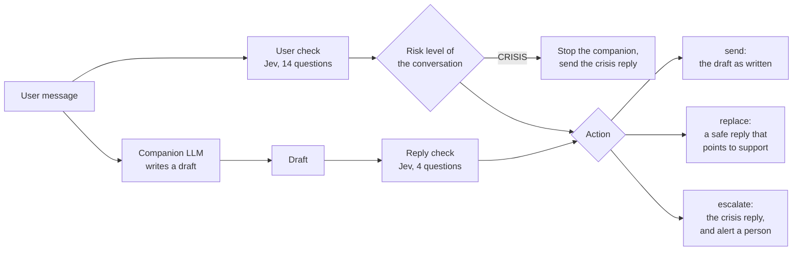

# FirstRead

A safety layer for mental health companion chatbots. FirstRead reads every turn before
anything reaches the user. It checks the user's message for signs of self-harm risk, then
checks the companion's draft reply before it's sent. Both checks are one call each to
[Jev](https://vercel.com/docs/ai-gateway/sdks-and-apis/typesafe) through Vercel AI Gateway,
which answers a set of yes/no questions with probabilities fast enough to run on every turn.

It's for teams building companion apps who need risk caught and routed to a person, without
making every reply wait. Built for the **What Would Jev Do?** hackathon (Oct 6–11, 2026).

- **Live demo:** https://firstread-mu.vercel.app/demo. Recorded scenarios play with no key, and typed messages run on the demo's key, within limits.
- **Deck:** https://firstread-mu.vercel.app/deck

On the 2,044-message test split of the Between Help and Harm benchmark, Jev scores
**AUC 0.992** and catches **96% of self-harm messages at a 5% false-alarm rate**, with a
**0.50s** median check, at about **$0.04 per 1,000 checks**. It beats every general model we
tried, on accuracy, speed and cost.

## How a turn works



- **The user check runs while the companion writes** (`guard.startTurn()`), so it adds almost
  no wait. If it reaches CRISIS, the companion is stopped and the crisis reply goes out at once.
- **The draft is checked before anyone sees it** (`finish(draft)`). Nothing the companion writes
  reaches the user unchecked.
- **Both checks must answer within 3s of the draft being ready.** If Jev is slow, rate-limited or
  down, FirstRead **fails closed**: the draft isn't sent, and the user gets a reply matched to the
  risk level already known (a gentle holding reply, the support reply, or the crisis reply). Those
  turns are marked in `audit.failures`; re-check them later with `guard.recheck()`.

**The risk level belongs to the conversation, not to one message** (`risk.ts`). It rises as soon
as a message warrants it, and one calm message never lowers it. ELEVATED settles to WATCH after
several calm turns in a row (`settleAfter`), never to NONE. Only a person clears CRISIS
(`clearCrisis()`), and only down to ELEVATED. At WATCH and above, a draft that brushes the risk
off is replaced.

**Jev's probabilities rise with real risk.** On the test split, the share of real self-harm
messages rises at every step of Jev's probability, so a cutoff means the same thing on every
message. In the middle range the numbers run low, so FirstRead's cutoffs are set from measured
recall rather than read as odds.

## Results

### Single messages: Jev against four general models

BHH test split, 519 self-harm messages against 1,231 with no risk. Every model answered all
2,044 messages. Each model gets the same questions about the same text, and is scored in the best
way it allows; the cutoff is swept per model, so no model is judged on cutoffs tuned for Jev.

| Model | Scored by | AUC [95% CI] | Recall at 5% false alarms | Median check | 90th percentile | Over 3s | $ per 1,000 checks |
| --- | --- | --- | --- | --- | --- | --- | --- |
| **Jev** | its own probabilities | **0.992** [0.988, 0.995] | **96%** | **0.50s** | **0.67s** | 0% | **$0.04** |
| glm-5.3-flash | stated probabilities, low thinking | 0.976 [0.966, 0.984] | 93% | 1.56s | 2.29s | 4% | $0.21 |
| gemini-3.8-flash | stated probabilities, low thinking | 0.973 [0.963, 0.982] | 92% | 2.79s | 5.29s | 41% | $1.69 |
| deepseek-v4.1-flash | stated probabilities, low thinking | 0.966 [0.954, 0.976] | 91% | 7.31s | 13.50s | 94% | $2.04 |
| gpt-6-luna | true/false token probabilities, thinking off | 0.933 [0.919, 0.948] | 88% | 1.26s | 1.50s | 0% | not recorded |

- **Jev's lead is real against every model:** the paired 95% interval of each AUC difference
  is above zero. GLM comes closest (0.016 [0.009, 0.025]). Against it, Jev's case is mostly
  speed (3× faster) and cost (about 5× cheaper).
- **Jev's answers are usable as scores.** 23% of its answers are at 0 or 1, against 64–98% for the
  others, so there are real cutoffs to choose between.
- **As deployed** (the cutoffs in `policy.ts`), 96% of self-harm messages reach ELEVATED, and 4%
  of no-risk messages do. 24% of no-risk messages reach WATCH, which only makes the reply check
  stricter.
- The gateway returns no token probabilities for the flash models, so they state a probability per
  question, like gpt-6-sol. Luna was called at OpenAI directly; the others went through the
  gateway, so the gateway hop is in their times. Costs are list prices (`PRICES` in
  `evals/llm-client.ts`) times each run's token counts.

AUC, recall, latency and the share of 0-or-1 answers are in `apps/web/slides/data/bhh.json`, the
file the deck reads. To reproduce (the dataset is CC-BY-NC-4.0 and isn't committed):

```bash
pnpm fetch:bhh
pnpm eval:bhh --split test --concurrency 8              # Jev
pnpm eval:bhh --split test --client glm --concurrency 4 # or luna, gemini, deepseek
pnpm compare:bhh --split test                           # the table above
```

### How we got there

After the first version, each change started from a miss, was made in code, and was scored on the
test split with that commit's `policy.ts` (`apps/web/slides/data/iterations.json`):

| Change | Recall | False alarms |
| --- | --- | --- |
| The start: Columbia-style questions, one cutoff per question and level | 88.1% | 1.5% |
| Follow-up questions for borderline turns, where weak signals add up | 95.4% | 3.2% |
| A question about preparation (goodbye letters, gathering means) | 96.0% | 3.5% |

### Conversations: risk across turns

Every BHH case is one message. `evals/conversations.jsonl` holds 58 synthetic conversations that
test what only shows across turns: risk that builds slowly, risk raised before the user check's
8-turn window, recovery after a disclosure, framing that shifts mid-way, and hyperbole in a safe
chat. Each exchange has a label: the level a careful reader would reach, and the highest they'd
still call reasonable. Run on Oct 11, with the current `policy.ts`:

| Split | Conversations | Should escalate | Missed | Late | Over the ceiling | Settled on time |
| --- | --- | --- | --- | --- | --- | --- |
| dev, used for tuning | 37 | 22 | 0 | 0 | 9 conversations (24 exchanges) | 2 of 2 |
| holdout, only for checking | 21 | 12 | 1 | 0 | 5 conversations (19 exchanges) | 0 of 1 |

FirstRead almost never misses a conversation; its weakness is going higher than it should. Most of
the over-the-ceiling turns are one message read as ELEVATED on its own: an opener a careful reader
would hold at WATCH, worry about a friend, or a joke about jumping out of a window over a video
game read as CRISIS. Once there, the level stays up, by design. The holdout miss is
`disguised-pets`: asking who would look after their cats if they died, which is preparation.
About 60 conversations are enough to find patterns and specific
misses, not to report percentages, so the table gives counts.

```bash
pnpm eval:conversations                 # dev split
pnpm eval:conversations --split holdout
pnpm eval                               # 49 short single-message cases
```

### Keeping the numbers honest

- **Test messages never shaped the questions Jev is asked.** An early draft's examples echoed test
  messages; we caught it and rewrote them before measuring.
- **Tune on one set, report on another.** BHH validation to tune, test to report. One later fix
  (`67e0369`) looked at a test miss; the iteration recall above predates it.
- **Conversation labels were written before any run.** The holdout split is run to confirm a
  change, never to tune one.
- **The test split's labels are weaker.** BHH's 206 validation messages are labelled by people; its
  2,046 test messages by gpt-4o-mini (majority of 3 runs). Validation is spent on tuning, so test
  is what we report.

## Quickstart

Requires Node 22+ and pnpm 10.

```bash
pnpm install
pnpm test     # policy, wiring and demo tests, no keys needed
pnpm dev      # http://localhost:3000: the deck at /deck, the demo at /demo
```

With no keys, the tests, the deck and the demo's recorded scenarios all work. For typed messages
and the evals, copy `.env.example` to `.env` at the repo root and fill in:

| Variable | What it's for |
| --- | --- |
| `AI_GATEWAY_API_KEY` | Jev, through Vercel AI Gateway. Or set `TYPESAFE_API_KEY` for a direct TypeSafe key. Also needed for `pnpm --filter web build`. |
| `OPENAI_API_KEY` | The demo's companion (gpt-6-sol), and the gpt-6-luna and gpt-6-sol baselines in the evals. |
| `KV_REST_API_URL`, `KV_REST_API_TOKEN` | Optional locally. Upstash Redis for the demo's sessions and limits. Without them, sessions live in memory. A production deployment without them won't run typed messages on its own key. |

`pnpm demo` runs a terminal chat; plug your companion into `draftReply()` in
`packages/firstread/examples/chat-demo.ts`.

## Safety and scope

FirstRead flags risk and routes conversations to people. It doesn't diagnose, and it isn't a
replacement for human crisis support. The questions are loosely structured like the Columbia
Protocol (ideation, then plan, then intent), but they aren't a validated clinical instrument.

**The public demo is honest about what it is:**

- A notice is always on screen. The demo is not a support service, no one reads the chats,
  and the Singapore crisis lines and emergency number are shown at every width.
- The crisis reply says a person would be alerted in a real deployment, that this demo can't do
  that, and where to get help now. It never promises a person who isn't coming.
- The scenarios are recordings of the live pipeline (real Jev, the real companion, real timings),
  and each is labelled with the date it was recorded. Scenarios whose live runs go above their
  labels are held back.

**What's kept and logged:**

- Conversations aren't logged. The server logs only an error's type, status and message, with
  OpenAI keys redacted. `TYPESAFE_LOG_LEVEL=debug` must never be set in production, because the
  SDK's debug logs include message bodies.
- Sessions (the conversation and its risk level) are kept in Redis for 2 hours, then expire.
- A visitor's own OpenAI key stays in that browser tab (sessionStorage). It's sent with each
  request and used for that request only, never stored on the server.
- Messages go to OpenAI for the companion, and to Jev through AI Gateway for the checks.

**Limits on the public demo's key:** 30 messages per conversation, and 60 a day per IP. Any key gets
8 messages a minute per IP. A message can be up to 2,000 characters.

**Still open:**

- **The reply check has no eval of its own.** Its cutoffs aren't measured on labelled replies yet.
  Late in a recovered conversation, it still replaces some calm replies.
- **Conversations can go higher than they should** (above). Demo scenarios that do are held back
  until that's fixed.
- **No fallback classifier.** When the gateway fails, FirstRead fails closed: safe, but the message
  goes unread.

## Layout

A pnpm workspace. The library has no framework, so any companion app can use it. The Next.js app
holds the deck and the demo.

| Path | What it is |
| --- | --- |
| `packages/firstread/src/questions.ts` | The questions Jev answers: 14 for the user check, 4 for the reply check |
| `packages/firstread/src/policy.ts` | Cutoffs: Jev's probabilities to a risk level, and to an action |
| `packages/firstread/src/risk.ts` | The conversation's risk level: how it rises, settles and is cleared |
| `packages/firstread/src/guard.ts` | `FirstRead`: runs both checks, the deadline and failing closed |
| `packages/firstread/src/jev.ts` | Jev through TypeSafe's SDK (`@typesafe-ai/sdk`), routed through AI Gateway |
| `packages/firstread/src/templates.ts`, `resources.ts` | Fallback replies, and verified crisis lines by country (Singapore first) |
| `packages/firstread/evals/` | The BHH, conversation and single-message evals ([README](packages/firstread/evals/README.md)) |
| `apps/web/lib/turn.ts` | One demo turn: the user check alongside the companion, the CRISIS short-circuit, the reply check |
| `apps/web/app/api/chat/route.ts` | The demo's chat endpoint: sessions, limits and keys |
| `apps/web/slides/` | The deck. Every number on it is read from `slides/data/` or the library |
